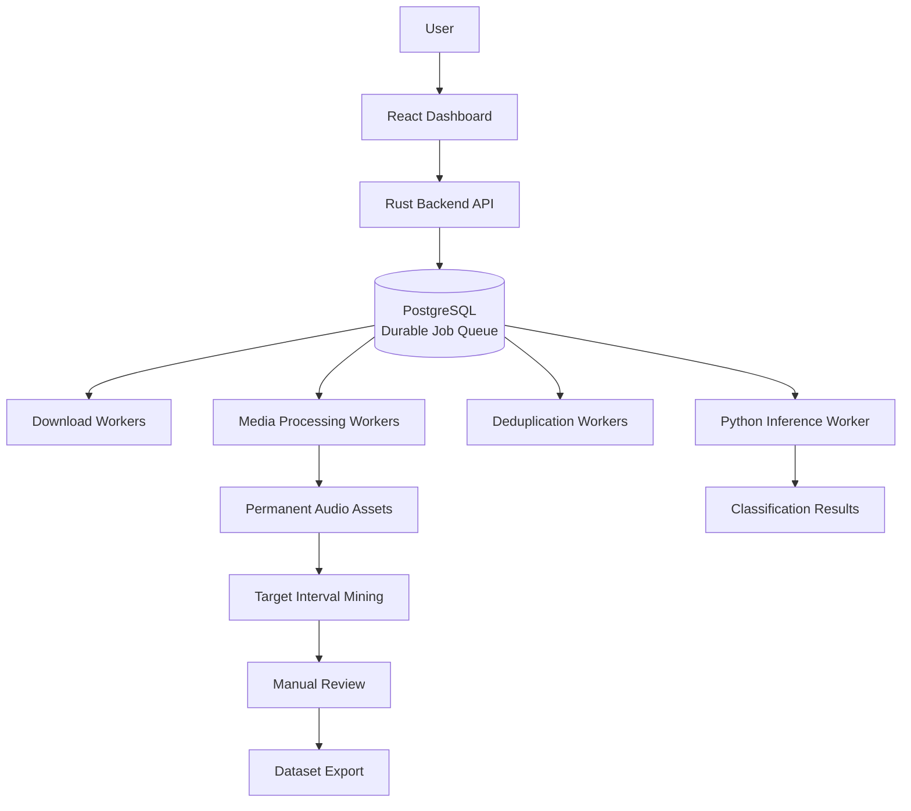
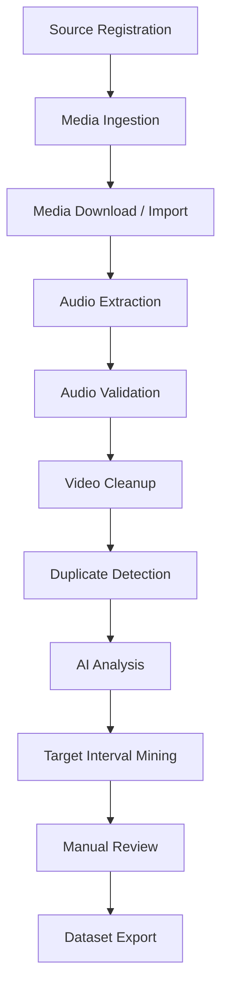

# Data Studio


Local-first Persian audio dataset builder for ingesting media,
extracting normalized audio, removing supported duplicates, and
exporting curated datasets.

## Project Overview

Data Studio is a local, asynchronous pipeline for building
large-scale Persian audio datasets. It is designed for a single
workstation, restart-safe processing, and storage efficiency.

## Key Features

- Local-first operation with no cloud services
- Rust-owned orchestration and business logic
- PostgreSQL as the only database and durable job queue
- React dashboard for workspace and operational visibility
- Python inference worker isolated from orchestration
- Asynchronous, idempotent, restart-safe processing
- Temporary video handling with permanent audio storage
- Dataset export in standard formats

## Architecture Overview



## Technology Stack

| Layer | Technology |
| --- | --- |
| Backend orchestration | Rust, Axum, SQLx, Tokio, Tracing |
| Dashboard | React, Vite, TypeScript, Vitest |
| Inference worker | Python 3.11+, setuptools, pytest |
| Database | PostgreSQL 16 |
| Local runtime | Docker Compose |

## Repository Structure

| Path | Purpose |
| --- | --- |
| [`crates/backend`](crates/backend) | Rust backend service and tests |
| [`packages/frontend`](packages/frontend) | React dashboard |
| [`services/inference-worker`](services/inference-worker) | Python inference worker |
| [`docs`](docs) | Source-of-truth product and architecture docs |
| [`migrations`](migrations) | Root SQL migrations |
| [`docker`](docker) | Dockerfiles for local containerized runs |
| [`tests`](tests) | Repository-level test fixtures and helpers |
| [`fixtures`](fixtures) | Shared test fixtures |
| [`scripts`](scripts) | Local tooling scripts |

## Processing Pipeline



Pipeline properties:

- Each asset progresses independently
- Stages run asynchronously and incrementally
- State is persisted in PostgreSQL
- Temporary videos are deleted after validated audio is finalized
- Duplicate detection and later stages only act on persisted pipeline state

## Prerequisites

- Rust toolchain with the repo's `rtk` wrapper available
- Node.js 24+ and `pnpm`
- Python 3.11+
- Docker and Docker Compose

## Quick Start

```bash
rtk cargo metadata --no-deps
pnpm --dir packages/frontend install --frozen-lockfile
docker compose up --build
```

Open the dashboard at `http://localhost:5173`.

## Local Development

Backend:

```bash
rtk cargo fmt --check
rtk cargo clippy --workspace --all-targets -- -D warnings
rtk cargo test --workspace
```

Frontend:

```bash
pnpm --dir packages/frontend test
pnpm --dir packages/frontend dev
```

Python worker:

```bash
pytest services/inference-worker
```

## Docker Deployment

```bash
docker compose up --build
```

Services defined in [`docker-compose.yml`](docker-compose.yml):

- PostgreSQL on `5432`
- Rust backend on `8080`
- React frontend on `5173`
- Python inference worker on `8090`

## Configuration (.env)

Root example: [`.env.example`](.env.example)

Frontend example: [`packages/frontend/.env.example`](packages/frontend/.env.example)

Inference worker example: [`services/inference-worker/.env.example`](services/inference-worker/.env.example)

Key variables:

| Variable | Purpose |
| --- | --- |
| `DATA_STUDIO_DATABASE_URL` | PostgreSQL connection string |
| `DATA_STUDIO_WORKSPACE_DIR` | Repository or workspace root |
| `DATA_STUDIO_DATA_DIR` | Persistent local data directory |
| `DATA_STUDIO_TEMP_DIR` | Temporary processing directory |
| `DATA_STUDIO_AUDIO_DIR` | Permanent audio storage root |
| `DATA_STUDIO_AUDIO_TEMP_DIR` | Temporary audio staging path |
| `DATA_STUDIO_HOST` | Backend bind host |
| `DATA_STUDIO_PORT` | Backend bind port |
| `DATA_STUDIO_INFERENCE_HOST` | Inference worker bind host |
| `DATA_STUDIO_INFERENCE_PORT` | Inference worker bind port |
| `VITE_API_BASE_URL` | Frontend API base path |

## Testing

Current repo validation commands:

```bash
rtk cargo fmt --check
rtk cargo clippy --workspace --all-targets -- -D warnings
rtk cargo test --workspace
pytest
pnpm --dir packages/frontend test
```

## Benchmarking

The backend includes a Criterion benchmark:

```bash
rtk cargo bench -p backend
```

## Logging

- Rust logging uses `tracing` and `tracing-subscriber`
- The backend supports structured, environment-filtered logging
- JSON formatting is available through the tracing subscriber configuration

## Documentation Index

- [Architecture](docs/architecture.md)
- [Pipeline](docs/pipeline.md)
- [Domain Model](docs/domain-model.md)
- [Product Scope](docs/product-scope.md)
- [Development Roadmap](docs/development-roadmap.md)
- [Phase 0 Tasks](docs/tasks/phase-0.md)
- [Phase 1 Tasks](docs/tasks/phase-1.md)
- [Phase 2 Tasks](docs/tasks/phase-2.md)
- [Phase 3 Tasks](docs/tasks/phase-3.md)
- [Phase 4 Tasks](docs/tasks/phase-4.md)

## Development Workflow

1. Read the source-of-truth docs under [`docs/`](docs).
2. Make the smallest possible change.
3. Update existing documentation only when behavior changes.
4. Run the narrowest relevant tests first.
5. Run the affected workspace checks before finishing.

## Roadmap

Completed:

- Phase 0: Foundation
- Phase 1: Ingestion
- Phase 2: Audio Processing
- Phase 3: Duplicate Detection
- Phase 4: Operational Dashboard / Dataset Workspace

Upcoming:

- Phase 5: AI Analysis

See the full roadmap in [docs/development-roadmap.md](docs/development-roadmap.md).

## Contributing

- Follow the existing docs and architecture constraints.
- Keep changes small and reviewable.
- Add or update automated tests for every completed task.
- Avoid introducing cloud services or new storage backends.

## License

No license file is present in this repository yet. The project is
currently unlicensed until a license is added.
